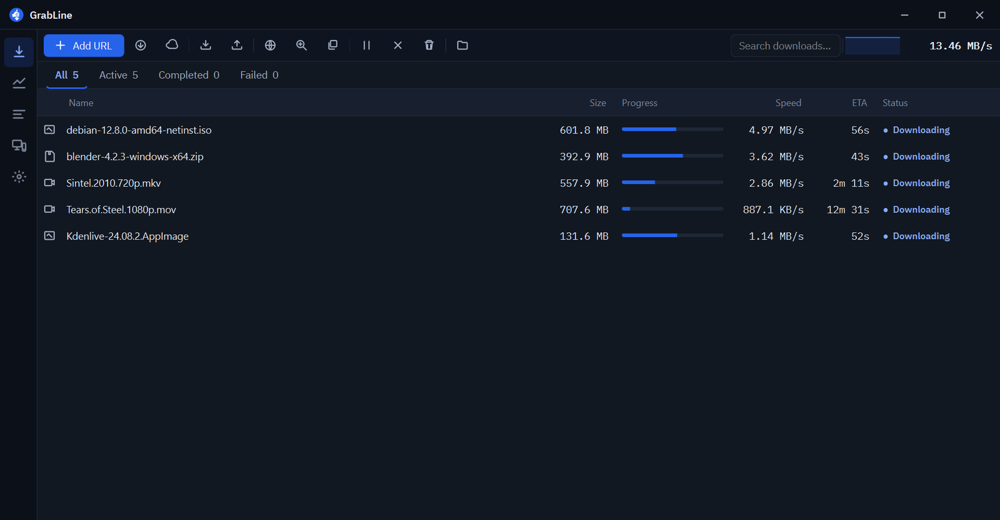
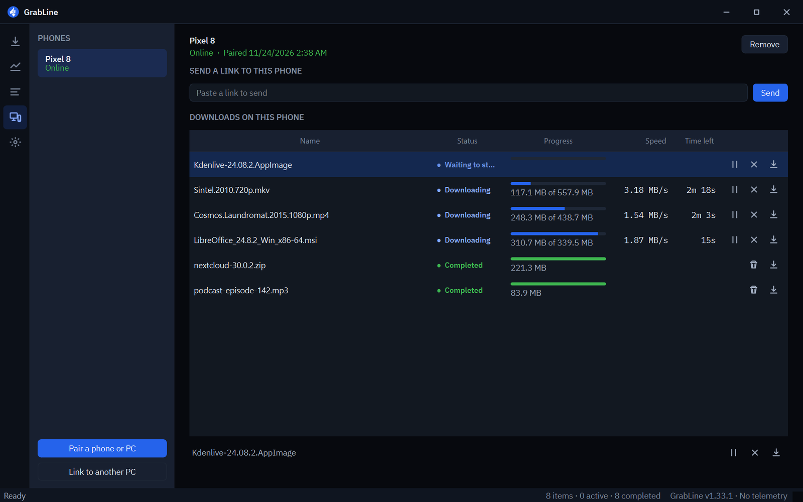
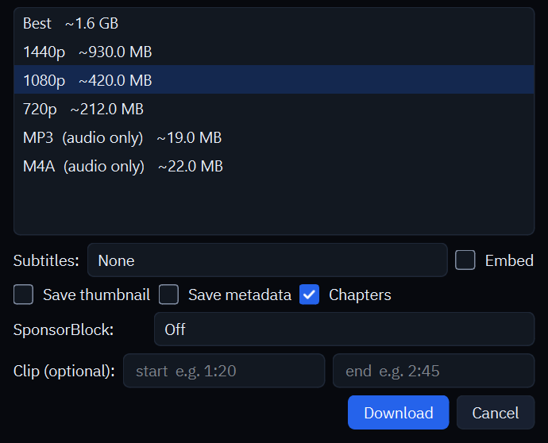
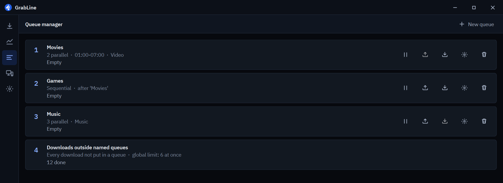
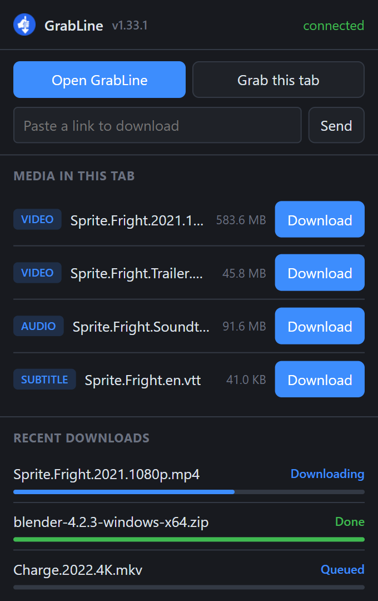
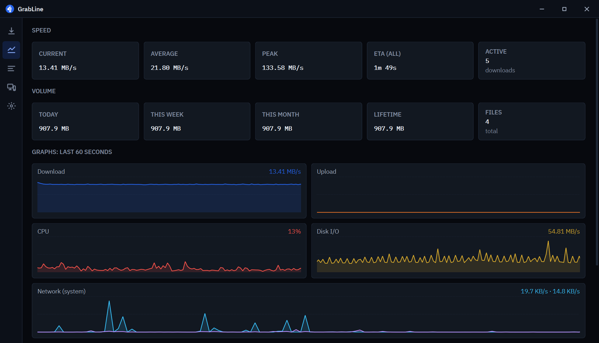
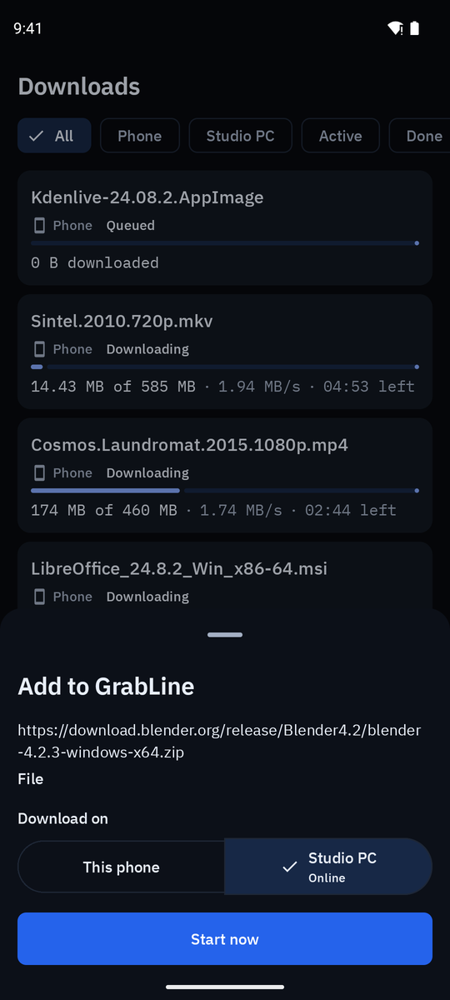

<div align="center">


# GrabLine

**Fast, free downloads on your PC and your Android phone.**

A download manager for Windows, macOS and Linux, with an Android app and a browser
extension. Open source, with no ads, no account and no usage telemetry.

[![Download][download-badge]][releases]
[![CI][ci-badge]][ci]
[![License: AGPL-3.0][license-badge]][license]
[![Firefox add-on][amo-badge]][amo]

**[Download][releases] · [Website][website] · [Android app][android] · [Documentation](docs/README.md) · [Report a bug][issues]**



</div>

Paste a link, drop it onto the window, send it from the browser with
**GrabLine Connect**, or share it from your phone. Ordinary files, video and audio,
torrents and server folders all go into the same list, with the quality and the
destination chosen before the download starts.

## Download

Get the installers and extension packages from the **[latest release][releases]**,
or let the [website][website] pick the right file for you. Packaged builds do not
need Python.

| Platform | Recommended package | Alternative |
| --- | --- | --- |
| Windows 10 or 11, x64 | `Grabline-Setup-<version>.exe` | `Grabline-<version>-windows-portable.zip` |
| macOS, Apple Silicon | `Grabline-<version>-applesilicon.dmg` | Build from source for other configurations |
| Linux x86-64 | `grabline_<version>_amd64.deb` | AppImage or tarball |
| Android 8 or later | [GrabLine for Android][android] | Universal APK on its release page |

Desktop builds are not code signed yet. See the [installation guide](docs/install.md)
for checksums, first launch, browser pairing and data locations. FFmpeg and Deno are
downloaded separately when a video first needs them; RAR and 7z extraction needs 7-Zip.

## Features

| Area | What you can do |
| --- | --- |
| File downloads | Split a file across up to 32 HTTP connections, resume after a crash or restart, retry and fall back to mirrors. |
| Video and audio | Choose the format through yt-dlp; download playlists, subtitles and chapters; skip sponsor segments; trim or convert with FFmpeg. What is available depends on the site. |
| Phones and PCs | Pair GrabLine for Android with a QR code, or link another PC. Send links between devices and see, pause or retry each one's downloads from the others, over your own network. |
| Browser integration | Hover buttons on media, a popup that lists what the page offers, image and link collection, a stream inspector and optional download takeover, through Native Messaging. |
| Torrents | Magnets, `.torrent` files, batches, RSS feeds and watch folders, with file selection and seeding limits. |
| Servers and cloud | FTP/FTPS, SFTP/SCP, WebDAV and S3-compatible storage, with secrets in the OS keyring. Public Google Drive and Dropbox links work too. |
| Queues and schedules | Named queues with their own limits, time windows, dependencies and categories; global, per-download and per-site speed limits. |
| File management | Categories, search, tags and notes, naming rules, duplicate finder, archive extraction and history import and export. |
| Desktop | Tray, notifications, shortcuts, light and dark themes with an accent colour, completion commands, queue-finished actions and 14 languages. |
| Safety | Checksums, optional antivirus and VirusTotal checks, TLS verification and archive path checks. |

### A closer look

<table>
  <tr>
    <td width="58%" valign="top"><br /><sub>A paired phone and its downloads, on the PC</sub></td>
    <td width="42%" valign="top"><br /><sub>Choosing a quality before the download starts</sub></td>
  </tr>
  <tr>
    <td valign="top"><br /><sub>Queues with limits, night hours and dependencies</sub></td>
    <td valign="top"><br /><sub>GrabLine Connect in the browser</sub></td>
  </tr>
  <tr>
    <td valign="top"><br /><sub>Live dashboard</sub></td>
    <td valign="top"><br /><sub>Sending a link from the phone to the PC</sub></td>
  </tr>
</table>

## Phones and other PCs

Open **Devices** in the sidebar and click **Pair a phone or PC**. Scan the QR code with
[GrabLine for Android][android], or type the address and code it shows. GrabLine asks
before it allows the device. **Link to another PC** connects two copies of GrabLine the
same way. Pairing is encrypted, works only on private network addresses and never
opens a port on your router. The [Devices guide](docs/devices.md) has the details.

## Browser companion

- **Firefox:** install [GrabLine Connect from Mozilla Add-ons][amo].
- **Chrome, Edge and other Chromium browsers:** follow the app's **Browser Setup**
  instructions to load the unpacked extension. For development, use this repo's
  `extension/` folder so the pinned extension identity matches the native host.
- Launch GrabLine, pair the browser and open the extension popup to check the
  connection. [Extension setup and behaviour](extension/README.md) explains the
  difference between an unpaired host and an app that is closed.

The extension communicates over local stdio pipes, with no listening web server.
GrabLine opens no network port except the optional phone-remote listener, which
is off until you pair a phone and listens only on your local network. See the
[security model](docs/security-model.md#phone-remote-listener).
Download takeover can be disabled in its popup. Generated browser files and POST
exports stay in the browser; Firefox and Chromium use different takeover paths.

## Documentation

| Start here | Details |
| --- | --- |
| [Install and update](docs/install.md) | Packages, checksums, pairing, backups and uninstall |
| [Using GrabLine](docs/usage.md) | Downloads, media, queues and every settings section |
| [Phones and PCs](docs/devices.md) | Pairing a phone, linking PCs, sending links and fixing connections |
| [Troubleshooting](docs/troubleshooting.md) | Pairing, failed transfers, tools, logs and bug reports |
| [Contributing](CONTRIBUTING.md) | Development setup, checks and pull requests |
| [Windows development](docs/windows-development.md) | PowerShell setup and isolated Windows testing |
| [Testing and coverage](docs/testing.md) | Reproduction commands, evidence and known coverage limits |
| [Architecture and learning](docs/learn-grabline.md) | Trace a URL through the app and browser bridge |
| [Release notes](docs/releases/README.md) | Current changes and historical notes |

The [documentation index](docs/README.md) also links packaging, performance,
security, privacy and store-publishing references.

## Run from source

Use **Python 3.12** to match CI. See [Contributing](CONTRIBUTING.md) for Linux
system libraries and additional development tools.

**Windows PowerShell**

```powershell
git clone https://github.com/GrabLine/GrabLine.git
Set-Location GrabLine
py -3.12 -m venv .venv
.\.venv\Scripts\python.exe -m pip install -e ".[dev]"
.\.venv\Scripts\python.exe -m app
```

**Linux / macOS**

```sh
git clone https://github.com/GrabLine/GrabLine.git
cd GrabLine
python3.12 -m venv .venv
. .venv/bin/activate
python -m pip install -e ".[dev]"
python -m app
```

## Privacy and limits

GrabLine has no usage analytics or author-operated download service. Downloads,
update checks, tool provisioning and enabled integrations contact their respective
services. Browser sessions and handed-off request headers may contain sensitive
data; see the [privacy policy](PRIVACY.md) before sharing logs or backups.

GrabLine does not bypass DRM or account access restrictions. Only download
content you are entitled to access. Local test coverage does not certify every
yt-dlp site, private cloud provider or hardware-dependent action; the
[testing guide](docs/testing.md) records those limits.

## Support and license

[Report a reproducible issue][issues], contribute a fix, or
[support development on Ko-fi][support]. Report exploitable vulnerabilities
privately through [the security policy](SECURITY.md).

Licensed under [AGPL-3.0-or-later][license]. Dependency licenses remain their
own; FFmpeg and Deno are provisioned separately rather than bundled in installers.

[releases]: https://github.com/GrabLine/GrabLine/releases/latest
[website]: https://grabline.github.io/
[android]: https://github.com/GrabLine/grabline-android
[issues]: https://github.com/GrabLine/GrabLine/issues
[amo]: https://addons.mozilla.org/en-US/firefox/addon/grabline-connect/
[support]: https://ko-fi.com/zain021xd
[license]: LICENSE
[ci]: https://github.com/GrabLine/GrabLine/actions/workflows/ci.yml
[download-badge]: https://img.shields.io/github/v/release/GrabLine/GrabLine?label=download&color=2563EB
[ci-badge]: https://img.shields.io/github/actions/workflow/status/GrabLine/GrabLine/ci.yml?branch=main&label=CI
[license-badge]: https://img.shields.io/badge/license-AGPL--3.0--or--later-2563EB
[amo-badge]: https://img.shields.io/amo/v/grabline-connect?label=Firefox&color=ff7139
