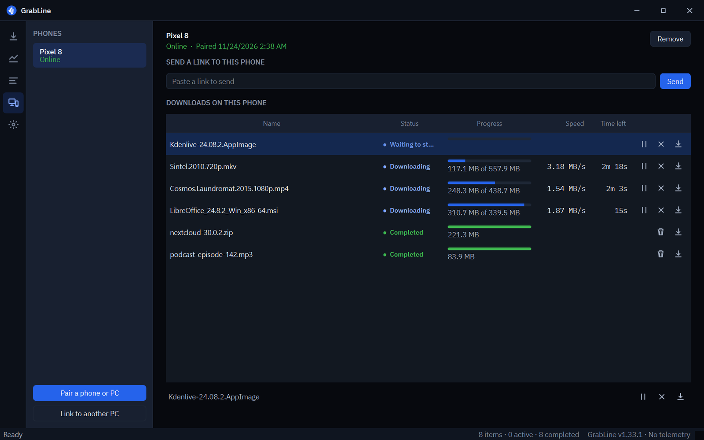

# Phones and PCs

GrabLine on your PC can pair with [GrabLine for Android](https://github.com/GrabLine/grabline-android)
and link with GrabLine on another PC. Paired devices appear on the **Devices** page in
the sidebar. From there each one can send links to the others and see, pause, resume,
cancel or retry the others' downloads.

Everything happens on your own network. There is no GrabLine account or server, and
GrabLine never opens a port on your router.

## Pair a phone

1. Connect the phone and the PC to the same Wi-Fi or network.
2. On the PC, open **Devices** and click **Pair a phone or PC**. A QR code appears,
   with the PC's address and a code under it.
3. In GrabLine for Android, open **Devices** and tap **Pair a PC**, then scan the code.
   If the camera does not work, tap **Enter the code by hand** and type the address and
   code shown under the QR code. Lowercase and missing dashes are fine.
4. The PC asks whether to allow the phone. Click **Allow**. The button can be pressed
   one second after the prompt appears, so a key you were typing elsewhere cannot
   approve a device by accident. Escape or closing the prompt denies it.

A code works once and expires after two minutes. After five wrong codes GrabLine locks
that code; click **New code** to start again.

## Link another PC

On the second PC, open **Devices**, click **Link to another PC**, and type the address
and code that the first PC shows under **Pair a phone or PC**. The first PC asks before
it allows the link. One link gives control in both directions. If you do not want
linked PCs to control this PC, turn off **Let linked PCs see and control downloads on
this PC** in **Settings, Phones and PCs**.

## What you can do once paired

- **Send a link.** Select a device in Devices, paste a link and click **Send**. On the
  phone, share a link to GrabLine and choose the PC.
- **Watch and control downloads.** The device's downloads show live with speed and time
  left, and buttons to pause, resume, cancel, retry or remove them. For a phone job you
  can also choose **Download on this PC instead**.
- **Copy a finished file.** On the phone, open a finished PC download and copy it to the
  phone. The copy is checked with SHA-256.
- **Remove a device.** Select it and click **Remove**. Its access ends at once. A linked
  PC lets you choose whether to remove the link on this PC only or on both.

## When a device will not connect

| What you see | What to try |
| --- | --- |
| The phone keeps trying and then gives up | Check both are on the same network and not on a guest Wi-Fi that keeps devices apart. A VPN on the phone can also block local addresses. |
| Nothing reaches the PC at all | Windows asked about the firewall the first time GrabLine listened, and **Cancel** blocks it. Open **Windows Security, Firewall and network protection, Allow an app through firewall**, find GrabLine and tick **Private**. |
| The phone says the PC's identity changed | GrabLine was reinstalled or its data was reset, so the PC has a new key. Remove the PC on the phone and pair again. |
| The QR code will not scan | Make the window bigger or move closer, or use **Enter the code by hand**. |
| The PC is listed as offline | Make sure GrabLine is running on the PC and **Allow phones and PCs to connect** is on in **Settings, Phones and PCs**. |

The PC lists its own private addresses in the QR code, with the one your router uses
first. Addresses of virtual adapters (Hyper-V, WSL, VirtualBox, Docker and VPNs) go last.

## Privacy and security

The listener is off until you pair a device, and it only accepts connections from
private and link-local addresses. Every connection is encrypted with TLS, the phone
checks the PC's key on every connection, and each paired device signs in with its own
key. Pairing codes and device keys are never written to the log. The
[security model](security-model.md#phone-remote-listener) has the full description, and
the [protocol](https://github.com/GrabLine/grabline-android/blob/main/docs/PROTOCOL.md)
lives in the Android repository.
